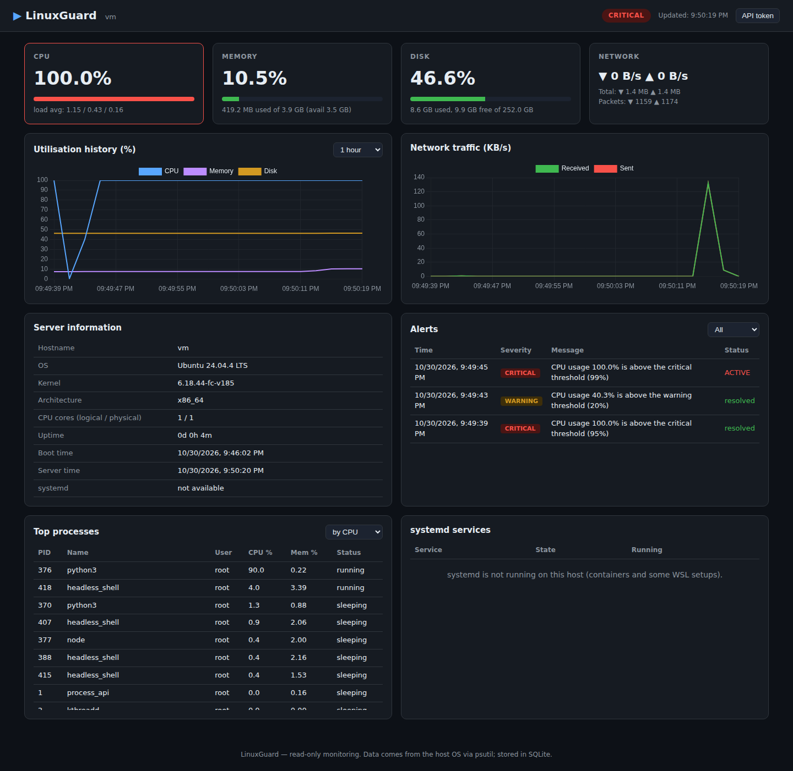
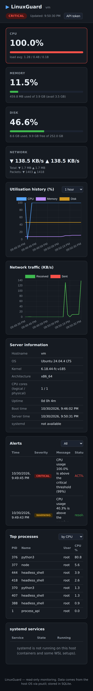
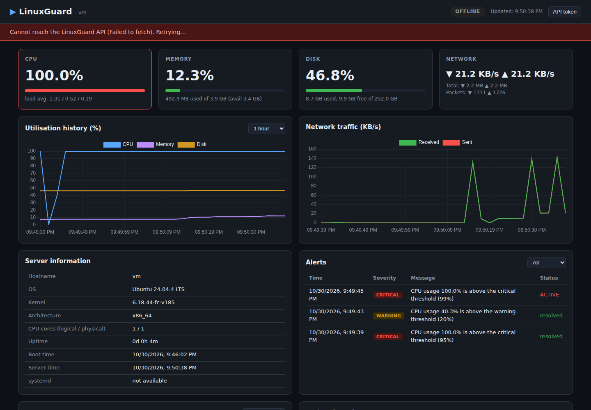

# LinuxGuard — Linux Server Monitoring & Infrastructure Automation

LinuxGuard watches the health of a Linux server and shows it on a dark, responsive web dashboard. A background
agent reads real metrics from the operating system (via `psutil` and `/proc`), stores history in SQLite,
raises de-duplicated threshold alerts, and exposes everything through a REST API. Bash scripts, a systemd unit,
cron examples, Docker and an AWS EC2 guide cover the operations side.

> Built as a beginner-level infrastructure engineering portfolio project. See [Limitations](#limitations) for an honest scope statement.

## Problem statement
Administrators need to know when a server is running out of CPU, memory or disk *before* it fails, and need a
history to troubleshoot after the fact. Commercial stacks (Prometheus/Grafana, Zabbix) are powerful but heavy.
LinuxGuard is a small, readable implementation of the same core ideas: collect → store → evaluate → alert → visualise.

## Features
- **Overview:** hostname, OS, kernel, architecture, cores, uptime, overall health (healthy / warning / critical)
- **CPU:** utilisation %, core count, load averages, history, alerts
- **Memory:** total / used / available / %, history, alerts
- **Disk:** total / used / free / % (same figure as `df`), history, alerts
- **Network:** cumulative bytes & packets plus per-second rates (counter resets handled), traffic chart
- **Processes:** top N by CPU or memory — **read-only** (no kill endpoint exists); first-seen processes show `—` instead of a fake 0 %; exited/denied processes are skipped safely
- **systemd services:** read-only `systemctl is-active` for an allow-list; graceful message where systemd is absent (containers, some WSL)
- **Alerts:** configurable warning/critical thresholds; one active alert per (host, metric); escalation; **hysteresis** (an alert clears only below threshold − 5 points, so values near a limit don't flap); auto-resolve; full history
- **History:** timestamped SQLite records, retention pruning, down-sampled chart API
- **Automation:** `system_info.sh`, `health_check.sh` (exit codes 0/1/2), `backup.sh` (online SQLite backup + integrity check + rotation)
- **Ops:** Dockerfile, Compose (persistent volume, health check, restart policy, non-root, read-only rootfs), systemd unit, cron examples

## Tech stack
Python 3.12 · Flask · psutil · waitress · SQLite (WAL) · HTML/CSS/JS · Chart.js (vendored) · Bash · Docker/Compose · systemd · cron · pytest

## Architecture
```
Linux OS (/proc, df, systemctl) ──> monitor.py (read-only collection)
                                        │
          collector.py (background thread, every N s)
                 │                      │
                 ▼                      ▼
        database.py (SQLite)      alerts.py (thresholds + de-dup)
                 ▲                      │
                 └──── Flask REST API (routes/) ◄── Dashboard (HTML/JS/Chart.js)
```
The collector runs whether or not a browser is open. More detail: [docs/ARCHITECTURE.md](docs/ARCHITECTURE.md).

## Project structure
```
backend/   app.py (factory+server) config.py models.py database.py monitor.py alerts.py collector.py security.py
           routes/ metrics.py alert_routes.py processes.py services.py _util.py
frontend/  index.html style.css dashboard.js vendor/chart.umd.js
scripts/   system_info.sh health_check.sh backup.sh
deploy/    linuxguard.service linuxguard.cron
tests/     test_monitor.py test_alerts.py test_collector.py test_api.py conftest.py
docs/      ARCHITECTURE.md AWS_DEPLOYMENT.md HANDOVER.md INTERVIEW_PREPARATION.md TROUBLESHOOTING.md FINAL_AUDIT.md
Dockerfile docker-compose.yml requirements.txt .env.example
```

## Run locally (Ubuntu / WSL2)
```bash
python3 -m venv .venv && source .venv/bin/activate
pip install -r requirements.txt
cp .env.example .env            # optional; defaults work
python -m backend.app           # http://127.0.0.1:5000
```
To load `.env`: `set -a; source .env; set +a` before starting. **WSL2:** works the same; systemd may be off
(the Services panel then explains that). Enable it with `[boot] systemd=true` in `/etc/wsl.conf`, then `wsl --shutdown`.

## Run with Docker
```bash
cp .env.example .env     # set LINUXGUARD_API_TOKEN
docker compose up -d --build
curl http://127.0.0.1:5000/api/health
docker compose logs -f
```
Data lives in the `linuxguard-data` volume and survives `docker compose down` / rebuilds. The port is bound to
localhost by default. Note: inside a container, process/disk views describe the container's view — see TROUBLESHOOTING.

## Configuration (environment variables)
| Variable | Default | Meaning |
|---|---|---|
| `LINUXGUARD_HOST` / `PORT` | `127.0.0.1` / `5000` | bind address |
| `LINUXGUARD_DB` | `data/linuxguard.db` | SQLite path |
| `LINUXGUARD_POLL_SECONDS` | `5` | sampling interval (1–3600) |
| `LINUXGUARD_RETENTION_DAYS` | `7` | metric history kept |
| `LINUXGUARD_DISK_PATH` | `/` | mount point to monitor |
| `LINUXGUARD_SERVICES` | `ssh,cron,docker,nginx` | systemd allow-list |
| `LINUXGUARD_API_TOKEN` | *(empty)* | enables threshold edits; protects `/processes` & `/services` |
| `LINUXGUARD_HYSTERESIS` | `5` | alert recovery margin in percentage points (0–20) |
| `LINUXGUARD_DISABLE_COLLECTOR` | `0` | `1` = API only |

Default thresholds (warning / critical %): CPU 80/95, memory 85/95, disk 80/90 — editable via API.
With the default margin of 5, a CPU warning opens at 80 % and clears below 75 %; a critical opens at 95 % and, once below 90 %, steps down to a warning (if still ≥ 75 %) or resolves.

> **Single-process assumption:** run exactly one LinuxGuard process per database (the default `waitress` server uses threads, not worker processes). Each process starts its own collector, so multi-worker servers would collect duplicates.

## API
| Method & path | Purpose |
|---|---|
| `GET /api/health` | liveness: DB + collector stats (samples, failures, last success age); 503 if DB broken or collector dead/failing |
| `GET /api/overview` | system info, overall status, systemd availability |
| `GET /api/metrics/current` | latest reading + `age_seconds` + `stale` flag (live reading if DB empty) |
| `GET /api/metrics/history?metric=all\|cpu\|memory\|disk\|network&minutes=60&limit=300` | chart data |
| `GET /api/alerts?status=all\|active\|resolved&limit=50` | alert history |
| `GET /api/thresholds` | current thresholds |
| `PUT /api/thresholds/<cpu\|memory\|disk>` | body `{"warning":70,"critical":90}`; needs `X-API-Key` |
| `GET /api/processes?sort=cpu\|memory&limit=15` | top processes (token-protected if configured) |
| `GET /api/services` | systemd service states (token-protected if configured) |

Invalid input returns HTTP 400 with `{"error":"bad_request","message":...}`.
```bash
curl -X PUT -H "X-API-Key: $LINUXGUARD_API_TOKEN" -H "Content-Type: application/json" \
     -d '{"warning":70,"critical":90}' http://127.0.0.1:5000/api/thresholds/cpu
```

## Testing
```bash
python -m pytest -q          # 68 tests: monitor, processes, collector, DB, alerts + hysteresis, API, validation, auth
./scripts/health_check.sh; echo $?
./scripts/backup.sh
```

## Screenshots
Captured from the running application with headless Chromium (CPU load was generated and the CPU threshold lowered to 20 % to show an alert):





## Deployment
- **AWS EC2 + Docker:** [docs/AWS_DEPLOYMENT.md](docs/AWS_DEPLOYMENT.md) (documented guide; not executed by the author of this repo's initial build)
- **systemd:** `deploy/linuxguard.service` · **cron:** `deploy/linuxguard.cron`

## Security considerations
- No shell execution from the API; `systemctl` is called with an argument list and regex-validated names from a configured allow-list
- No process-kill/signal endpoint; monitoring is read-only
- All SQL parameterised; all query params range/enum validated; dashboard inserts data via `textContent` (no XSS)
- Optional API token (constant-time compare); write endpoints disabled unless a token is set
- Not run in debug mode; production WSGI server (waitress); security headers + CSP; generic 500 errors
- Container: non-root, read-only rootfs, all capabilities dropped, `no-new-privileges`
- **Limits:** no TLS or user accounts built in (put behind nginx/ALB with HTTPS, or use an SSH tunnel); the token travels in a header, so use HTTPS beyond localhost; unauthenticated read endpoints expose system info if you bind to a public address

## Limitations
- Monitors **one** host (schema has `hostname` columns to extend to many; no remote agents yet)
- Alerts are shown in the dashboard only (no email/Slack)
- Hysteresis margin is global (env var), not per-metric
- Docker and AWS steps were written but **not executed** (no Docker available in the build sandbox) — see docs/FINAL_AUDIT.md
- Process CPU % is per-core (can exceed 100 % on multi-core hosts), like `top`
- Dashboard verified in headless Chromium only (not Safari/Firefox)

## Future improvements
Multi-host agents posting to the API, email/Slack notifications, per-metric hysteresis, HTTPS reverse proxy config, Prometheus exporter, per-user auth, Docker container metrics.
